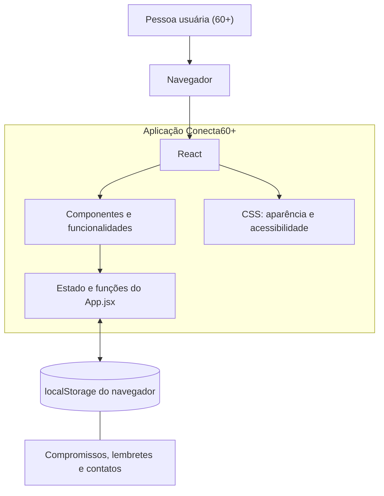

# Diagrama de Arquitetura — Conecta60+

O Conecta60+ é uma aplicação web desenvolvida com React e JavaScript. Os dados são armazenados no próprio navegador por meio do localStorage, sem a necessidade de um banco de dados ou servidor próprio.

## Representação da arquitetura

