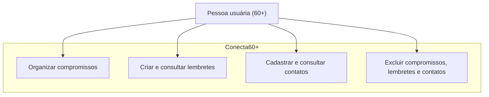

# Diagrama de Casos de Uso — Conecta60+

## Ator principal
- Pessoa usuária (60+)

## Casos de uso
- Acessar a plataforma.
- Visualizar a agenda.
- Cadastrar compromisso.
- Consultar compromissos.
- Excluir compromisso.
- Visualizar lembretes.
- Cadastrar lembrete.
- Consultar lembretes.
- Excluir lembrete.
- Visualizar contatos importantes.
- Cadastrar contato.
- Consultar contatos.
- Excluir contato.
- Iniciar ligação para um contato.

## Descrição
O diagrama representa as principais interações da pessoa usuária com o Conecta60+, permitindo organizar compromissos, criar lembretes e manter contatos importantes em uma interface simples e acessível.

## Diagrama

